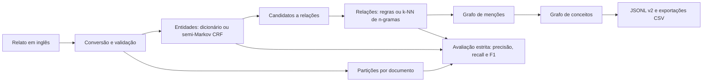
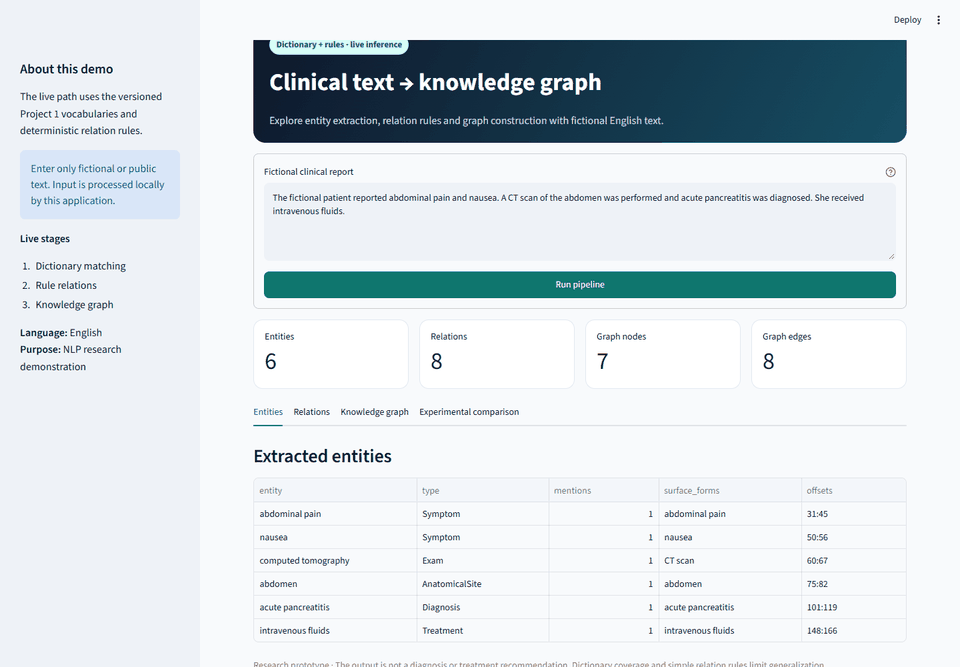

# Clinical NLP Knowledge Graphs | MC896

Projeto acadêmico de Processamento de Linguagem Natural (MC896, Unicamp) para transformar relatos de caso em entidades, relações e um grafo consultável. Esta cópia preserva o trabalho em grupo e serve de base para uma continuação individual de Gabriel Thomas Dias de Freitas. O marco e as alterações dessa continuação são identificados por commits posteriores ao projeto original.

> **Escopo:** o sistema estrutura evidências textuais para pesquisa em PLN. Não produz diagnóstico, decisão clínica ou recomendação de tratamento. A inferência atual usa métodos clássicos e supervisionados; modelos generativos não fazem parte do pipeline.

## My Contributions / Individual Extension

The original academic project and its core NLP pipelines were developed collectively by the four-person MC896 team. My post-fork work, recorded in the repository history, focused on turning that foundation into a reproducible portfolio project:

- built the local [Streamlit demonstration](#demonstração-interativa) for inspecting entities, relations, graphs, and experimental results ([`8464337`](https://github.com/gabrielthomasdf/Clinical-NLP-Knowledge-Graphs/commit/84643379d9e24505ae47d09230efb0d420a0f89a));
- packaged a deterministic, one-command [synthetic execution](#executar-sem-dados-clínicos) that does not require clinical datasets ([`5eb97e4`](https://github.com/gabrielthomasdf/Clinical-NLP-Knowledge-Graphs/commit/5eb97e4467874b231f160890b47a6d3774d7b652));
- reran and consolidated the five-fold nested cross-validation study, then published machine-checkable evidence and an artifact auditor ([`a20a6d2`](https://github.com/gabrielthomasdf/Clinical-NLP-Knowledge-Graphs/commit/a20a6d25adca60813731d67b9727be8caf790c87));
- organized and audited experimental results, source licenses, and the sanitized public history ([`a41f589`](https://github.com/gabrielthomasdf/Clinical-NLP-Knowledge-Graphs/commit/a41f589e506df01a1e1efb86340ccc616e731b35), [`9a48458`](https://github.com/gabrielthomasdf/Clinical-NLP-Knowledge-Graphs/commit/9a48458ab58dde3084ff8a2eb3caeb072d596747), [`b791405`](https://github.com/gabrielthomasdf/Clinical-NLP-Knowledge-Graphs/commit/b7914057b0596861fc63d6245e4a4530076ed743)); and
- expanded the architecture, reproduction, limitations, authorship, and data-provenance documentation ([`b2813f6`](https://github.com/gabrielthomasdf/Clinical-NLP-Knowledge-Graphs/commit/b2813f6e1df0f88f76f2dd35b18d07f30a79fa67)).

The [original team, repository provenance, and licensing](#origem-autoria-e-licença) remain fully credited. This section describes only the individual extension developed after the academic group project.

## O problema

Relatos clínicos contêm condições, achados, fatores e negações em texto livre. Para pesquisar e comparar esses elementos, o projeto identifica menções com offsets, classifica relações entre elas e constrói um grafo com proveniência. O Projeto 1 usa vocabulários, expressões regulares e regras; o Projeto 2 acrescenta uma avaliação supervisionada de abordagens alternativas.

## Arquitetura



As quatro combinações `dictionary+rules`, `dictionary+knn`, `crf+rules` e `crf+knn` compartilham contratos de predição. O grafo supervisionado distingue `Patient`, `Condition`, `Finding`, `Factor` e `Modifier`; suas relações avaliadas são `HAS_CONDITION`, `HAS_FINDING`, `HAS_FACTOR`, `NEGATES` e `CAUSES`. O [Projeto 1](project1/README.md) oferece ainda busca booleana, ranking TF-IDF, extração por regex e um grafo legado mais detalhado. As [decisões arquiteturais](project2_from_project1/docs/adr/) explicam a separação dos projetos e o esquema versionado.

## Demonstração interativa

<p align="center">
  
</p>

A aplicação é executada localmente e recebe um relato fictício ou público em inglês. A inferência ao vivo usa o pipeline clássico `dictionary+rules` para mostrar entidades, relações e o grafo construído. Os resultados de CRF e k-NN exibidos na aba de comparação vêm das avaliações experimentais auditadas e não são recalculados sobre o texto digitado.

Antes de iniciar, crie e ative o ambiente e instale as dependências seguindo os passos de [execução sem dados clínicos](#executar-sem-dados-clínicos). Com o ambiente ativado, execute:

```bash
mc896-app
```

O comando inicia o Streamlit localmente e a interface abre em `http://localhost:8501`. Use apenas texto fictício ou público. A [captura estática da aplicação](project1/assets/portfolio/app-overview.png) também está disponível para visualização rápida.

## Executar sem dados clínicos

Requer Python 3.10 ou superior. A execução sintética usa CPU e cria 12 relatos fictícios determinísticos; serve para verificar a integração, **não** para estimar desempenho clínico.

```bash
python -m venv .venv
# Linux/macOS: source .venv/bin/activate
# Windows PowerShell: .\.venv\Scripts\Activate.ps1
python -m pip install --index-url https://download.pytorch.org/whl/cpu torch==2.14.1
python -m pip install -e .
mc896-demo
```

O comando imprime uma tabela das quatro abordagens fim a fim e grava tudo em `project2_from_project1/artifacts/portfolio-demo/`. As saídas incluem `output/manifest.json` com configuração, partições, versões e hashes; `output/entities/` e `output/relations/` com predições e métricas; e `output/graph/` com `graph.jsonl` nas camadas de menção e conceito. Os diretórios `artifacts/` são ignorados pelo Git. Use `mc896-demo --help` para escolher outro destino ou limite de iterações. Para reproduzir o estudo com os corpora originais, siga o [guia completo](project2_from_project1/docs/running-the-study.md); ele requer download e preparação dos dados e estima horas de treinamento do CRF.

### Exemplo observado

Trecho do documento fictício `synthetic:000`, gerado em `project2_from_project1/artifacts/portfolio-demo/input/corpus.jsonl`:

```text
She reported fatigue and chest pain. No nausea was observed. Asthma caused back pain.
```

Na execução local do braço `dictionary+rules` com 20 iterações máximas, o grafo conceitual continha as entidades `fatigue`, `chest pain`, `nausea`, `asthma`, `back pain` e `no`, entre outras, e a relação `CAUSES(asthma, back pain)`. Também gerou `NEGATES(no, nausea)` **e** `HAS_FINDING(Patient, nausea)`. Uma [etapa de consistência opcional](project2_from_project1/docs/negation-ablation.md) resolve o conflito por menção e preserva as predições acadêmicas originais para comparação. Os detalhes do exemplo estão em [demonstração reproduzível](project2_from_project1/docs/portfolio-demo.md).

## Dados, avaliação e resultados

- **Projeto 1:** o trabalho acadêmico usou 56 registros provenientes de 50 artigos MultiCaRe; alguns registros não representam um caso clínico individual. Os textos e seus derivados foram retirados de todo o histórico público. `project1/data/raw/metadata.csv` preserva origem e licença por artigo: 31 artigos `CC BY`, 11 `CC BY-NC-SA` e 8 `CC BY-NC`. Para reconstruir essa entrada, obtenha os dados na fonte e respeite a licença de cada artigo. Veja a [atribuição por artigo](DATA_ATTRIBUTION.md), a [auditoria dos dados no histórico](DATA_HISTORY_AUDIT.md) e o [MultiCaRe no Zenodo](https://zenodo.org/records/10079370).
- **Projeto 2:** usa o Medical Case Report Corpus (MCRC) para desenvolvimento supervisionado e MultiCaRe para avaliação externa. O corpus convertido, modelos e saídas com textos clínicos ficam fora do Git; a [preparação](project2_from_project1/README.md#preparação-dos-dados) registra hashes e a auditoria de sobreposição. [MCRC da Ada Health](https://github.com/adahealth/medical_case_report_corpus).
- **Separação:** os 53 documentos MCRC foram divididos por documento, com 42 no desenvolvimento e teste fixo separado. A avaliação de entidades exige tipo e offsets exatos; relações exigem endpoints e rótulo exatos. Um teto que recebe entidades *gold* é diagnóstico e não equivale a desempenho fim a fim.

Os números abaixo são os **resultados registrados no trabalho acadêmico** para o snapshot externo de 63 documentos elegíveis. Uma [auditoria local reproduziu a pontuação das predições congeladas](project2_from_project1/docs/portfolio-results-audit.md) com `report.json` idêntico, byte a byte, ao original; o [resumo verificável](project2_from_project1/docs/portfolio-results-evidence.json) publica hashes e métricas sem textos clínicos. Os artefatos de avaliação não estão versionados, portanto um clone público sozinho ainda não permite uma reprodução independente. O snapshot não alcançou o protocolo originalmente previsto de 100 documentos ou 20 relações por classe; `CAUSES` teve nove exemplos. O CRF terminou com valores finitos, mas sem convergir no limite de 250 iterações. Veja [protocolo e resultados](project2_from_project1/docs/external-final-evaluation.md).

| Pipeline | Macro-F1 entidades | Macro-F1 relações | Micro-F1 arestas conceituais |
| --- | ---: | ---: | ---: |
| Dicionário + regras | 0,1373 | 0,0458 | 0,0578 |
| Dicionário + k-NN | 0,1373 | 0,0601 | 0,0724 |
| CRF + regras | 0,2415 | 0,1078 | 0,0941 |
| CRF + k-NN | 0,2415 | 0,1123 | 0,1153 |

### Reprodução nos folds de desenvolvimento

Na continuação individual, o estudo completo foi reexecutado em 2026-11-04 sobre os 42 documentos de desenvolvimento, com cinco folds externos e seleção do CRF em três folds internos. A partição fixa de teste do MCRC não foi lida. Os valores abaixo são média ± desvio padrão entre os cinco folds.

| Pipeline | Macro-F1 entidades | Macro-F1 relações | F1 arestas conceituais |
| --- | ---: | ---: | ---: |
| Dicionário + regras | 0,1208 ± 0,0127 | 0,0404 ± 0,0069 | 0,0799 ± 0,0097 |
| Dicionário + k-NN | 0,1208 ± 0,0127 | 0,0632 ± 0,0095 | 0,1246 ± 0,0266 |
| CRF + regras | 0,2857 ± 0,0434 | 0,1364 ± 0,0314 | 0,1482 ± 0,0358 |
| CRF + k-NN | 0,2857 ± 0,0434 | 0,1555 ± 0,0382 | 0,2048 ± 0,0299 |

Os cinco ajustes externos do CRF produziram valores finitos, mas atingiram o limite de 250 iterações sem convergir. O [relatório de validação cruzada](project2_from_project1/docs/development-cross-validation-results.md) descreve o protocolo e os limites; o [resumo verificável](project2_from_project1/docs/development-cv-results-evidence.json) registra hashes, configurações e métricas sem textos clínicos. Esses valores exploratórios de desenvolvimento não são diretamente comparáveis à avaliação externa acadêmica acima.

Os valores de F1 da fixture sintética medem apenas a integração com dados artificiais. Não devem ser comparados com os resultados acima.

## Testes e estrutura

```bash
python -m pytest project1/tests/test_preprocessing.py project2_from_project1/tests/test_preprocessing.py project2_from_project1/tests/test_entities.py project2_from_project1/tests/test_relations.py project2_from_project1/tests/test_graph_build.py -q
```

`project1/` contém o pipeline clássico, busca e visualização local. `project2_from_project1/` contém contratos, extração supervisionada, avaliação, scripts e documentação do estudo. A aplicação Streamlit recebe texto fictício ou público e executa ao vivo a abordagem clássica; CRF e k-NN aparecem somente na comparação de resultados auditados, pois exigem modelos treinados. A [integração contínua](.github/workflows/basic-tests.yml) executa os testes básicos, o teste headless da interface e a demonstração sintética em CPU. A suíte completa passou localmente em 2026-11-03: **256 testes** (`python -m pytest -q`).

## Limitações e próximos passos

1. Avaliar a etapa opcional de consistência em validação por documento antes de incluí-la como padrão: na fixture sintética, ela removeu todos os conflitos, mas reduziu o F1 dos braços k-NN.
2. Definir um procedimento de aquisição que permita repetir a avaliação externa a partir das fontes autorizadas, mantendo as licenças e a proveniência de cada artigo sem redistribuir texto clínico neste repositório.
3. Treinar o classificador de relações com candidatos produzidos por predições *out-of-fold* do reconhecedor, mantendo partições por documento. Hoje o k-NN é ajustado sobre candidatos derivados das entidades *gold*.
4. Comparar n-gramas atuais com ponderação TF-IDF nos folds de desenvolvimento e medir precisão, recall e F1 por classe; reservar teste novo para a confirmação.
5. Exportar modelos supervisionados redistribuíveis e integrá-los à aplicação para comparar as quatro abordagens sobre o mesmo texto. Hoje somente `dictionary+rules` executa inferência ao vivo.

## Origem, autoria e licença

O [repositório acadêmico original](https://github.com/MatheuzRuf/projects-mc896) foi desenvolvido por **[Matheus Rufino da Silva (@MatheuzRuf)](https://github.com/MatheuzRuf), Gabriel Thomas Dias de Freitas, Daniel de Sousa Cipriano e Eduardo dos Santos Neres**. O histórico Git preserva a autoria dos commits e os créditos do grupo. A continuação individual começa após o commit acadêmico correspondente a `8f8c74a` no repositório original. A limpeza do histórico público preservou autores, datas e mensagens, mas alterou os hashes dos commits. Perfis GitHub dos demais integrantes serão adicionados quando fornecidos.

Os integrantes autorizaram a continuação e publicação, conforme informado por Gabriel. O código e sua documentação estão sob a [licença MIT](LICENSE), com os quatro integrantes identificados no aviso de autoria. Essa licença **não** altera os direitos sobre os relatos clínicos, metadados, anotações ou outros dados de terceiros: cada fonte mantém suas próprias condições, incluindo as restrições `NC` registradas nos metadados dos artigos. Modelos de linguagem foram usados como apoio a código, documentação e adjudicação, conforme descrito no [relatório do Projeto 2](project2_from_project1/README.md#como-modelos-de-linguagem-foram-usados), e não fazem inferência no pipeline.
