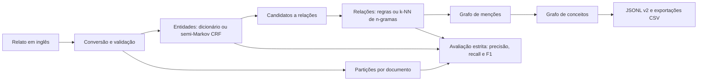

# Extração de informação clínica e grafos de conhecimento | MC896

Projeto acadêmico de Processamento de Linguagem Natural (MC896, Unicamp) para transformar relatos de caso em entidades, relações e um grafo consultável. Esta cópia preserva o trabalho em grupo e serve de base para uma continuação individual de Gabriel Thomas Dias de Freitas. O marco e as alterações dessa continuação serão identificados por commits posteriores ao projeto original.

> **Escopo:** o sistema estrutura evidências textuais para pesquisa em PLN. Não produz diagnóstico, decisão clínica ou recomendação de tratamento. A inferência atual usa métodos clássicos e supervisionados; modelos generativos não fazem parte do pipeline.

## O problema

Relatos clínicos contêm condições, achados, fatores e negações em texto livre. Para pesquisar e comparar esses elementos, o projeto identifica menções com offsets, classifica relações entre elas e constrói um grafo com proveniência. O Projeto 1 usa vocabulários, expressões regulares e regras; o Projeto 2 acrescenta uma avaliação supervisionada de abordagens alternativas.

## Arquitetura



As quatro combinações `dictionary+rules`, `dictionary+knn`, `crf+rules` e `crf+knn` compartilham contratos de predição. O grafo supervisionado distingue `Patient`, `Condition`, `Finding`, `Factor` e `Modifier`; suas relações avaliadas são `HAS_CONDITION`, `HAS_FINDING`, `HAS_FACTOR`, `NEGATES` e `CAUSES`. O [Projeto 1](project1/README.md) oferece ainda busca booleana, ranking TF-IDF, extração por regex e um grafo legado mais detalhado. As [decisões arquiteturais](project2_from_project1/docs/adr/) explicam a separação dos projetos e o esquema versionado.

## Executar sem dados clínicos

Requer Python 3.10 ou superior. A execução sintética usa CPU e cria 12 relatos fictícios determinísticos; serve para verificar a integração, **não** para estimar desempenho clínico.

```bash
python -m venv .venv
# Linux/macOS: source .venv/bin/activate
# Windows PowerShell: .\.venv\Scripts\Activate.ps1
python -m pip install --index-url https://download.pytorch.org/whl/cpu torch==2.14.1
python -m pip install -e .
python -m project2_from_project1.scripts.run_full_study --synthetic project2_from_project1/artifacts/demo-input --output-dir project2_from_project1/artifacts/demo-output --max-iterations 20
```

As saídas incluem `manifest.json` com configuração, partições, versões e hashes; `entities/` e `relations/` com predições e métricas; e `graph/` com `graph.jsonl` nas camadas de menção e conceito. Os diretórios `artifacts/` são ignorados pelo Git. Para reproduzir o estudo com os corpora originais, siga o [guia completo](project2_from_project1/docs/running-the-study.md); ele requer download e preparação dos dados e estima horas de treinamento do CRF.

### Exemplo observado

Trecho do documento fictício `synthetic:000`, gerado pelo comando acima:

```text
She reported fatigue and chest pain. No nausea was observed. Asthma caused back pain.
```

Na execução local do braço `dictionary+rules` com 20 iterações máximas, o grafo conceitual continha as entidades `fatigue`, `chest pain`, `nausea`, `asthma`, `back pain` e `no`, entre outras, e a relação `CAUSES(asthma, back pain)`. Também gerou `NEGATES(no, nausea)` **e** `HAS_FINDING(Patient, nausea)`: uma contradição a corrigir antes de usar a saída em qualquer cenário clínico. Os detalhes e os comandos para conferir os registros estão em [demonstração reproduzível](project2_from_project1/docs/portfolio-demo.md).

## Dados, avaliação e resultados

- **Projeto 1:** amostra versionada de 56 casos provenientes de 50 artigos MultiCaRe; `project1/data/raw/metadata.csv` registra origem e licença por artigo. Há 31 registros `CC BY`, 11 `CC BY-NC-SA` e 8 `CC BY-NC`. Essas condições devem ser respeitadas por qualquer reutilização dos textos e derivados. [MultiCaRe no Zenodo](https://zenodo.org/records/10079370).
- **Projeto 2:** usa o Medical Case Report Corpus (MCRC) para desenvolvimento supervisionado e MultiCaRe para avaliação externa. O corpus convertido, modelos e saídas com textos clínicos ficam fora do Git; a [preparação](project2_from_project1/README.md#preparação-dos-dados) registra hashes e a auditoria de sobreposição. [MCRC da Ada Health](https://github.com/adahealth/medical_case_report_corpus).
- **Separação:** os 53 documentos MCRC foram divididos por documento, com 42 no desenvolvimento e teste fixo separado. A avaliação de entidades exige tipo e offsets exatos; relações exigem endpoints e rótulo exatos. Um teto que recebe entidades *gold* é diagnóstico e não equivale a desempenho fim a fim.

Os números abaixo são os **resultados registrados no trabalho acadêmico** para o snapshot externo de 63 documentos elegíveis. Os artefatos de avaliação não estão versionados, portanto ainda falta uma reprodução pública independente. O snapshot não alcançou o protocolo originalmente previsto de 100 documentos ou 20 relações por classe; `CAUSES` teve nove exemplos. O CRF terminou com valores finitos, mas sem convergir no limite de 250 iterações. Veja [protocolo e resultados](project2_from_project1/docs/external-final-evaluation.md).

| Pipeline | Macro-F1 entidades | Macro-F1 relações | Micro-F1 arestas conceituais |
| --- | ---: | ---: | ---: |
| Dicionário + regras | 0,1373 | 0,0458 | 0,0578 |
| Dicionário + k-NN | 0,1373 | 0,0601 | 0,0724 |
| CRF + regras | 0,2415 | 0,1078 | 0,0941 |
| CRF + k-NN | 0,2415 | 0,1123 | 0,1153 |

Os valores de F1 da fixture sintética medem apenas a integração com dados artificiais. Não devem ser comparados com os resultados acima.

## Testes e estrutura

```bash
python -m pytest project1/tests/test_preprocessing.py project2_from_project1/tests/test_preprocessing.py project2_from_project1/tests/test_entities.py project2_from_project1/tests/test_relations.py project2_from_project1/tests/test_graph_build.py -q
```

`project1/` contém o pipeline clássico, busca e visualização local. `project2_from_project1/` contém contratos, extração supervisionada, avaliação, scripts e documentação do estudo. A interface web atual explora grafos já exportados; ainda não recebe livremente um novo relato para executar os quatro braços. A [integração contínua](.github/workflows/basic-tests.yml) executa os testes básicos em CPU.

## Limitações e próximos passos

1. Corrigir e testar a consistência entre negação e `HAS_FINDING`, identificada no exemplo sintético.
2. Publicar um pacote verificável de resultados sem redistribuir textos clínicos indevidamente; conferir os manifestos e as métricas do estudo original.
3. Treinar o classificador de relações com candidatos produzidos por predições *out-of-fold* do reconhecedor, mantendo partições por documento. Hoje o k-NN é ajustado sobre candidatos derivados das entidades *gold*.
4. Comparar n-gramas atuais com ponderação TF-IDF nos folds de desenvolvimento e medir precisão, recall e F1 por classe; reservar teste novo para a confirmação.
5. Criar uma interface para texto fictício ou público que mostre entidades, relações, grafo e comparação entre abordagens. A interface existente poderá ser adaptada antes de escolher Streamlit ou Gradio.

## Origem, autoria e licença

O [repositório acadêmico original](https://github.com/MatheuzRuf/projects-mc896) foi desenvolvido por **Matheus Rufino da Silva, Gabriel Thomas Dias de Freitas, Daniel de Sousa Cipriano e Eduardo dos Santos Neres**. O histórico Git preserva a autoria dos commits e os créditos do grupo. A continuação individual começa após o commit acadêmico `8f8c74a`, na branch `portfolio/gabriel-mc896`. A documentação e as correções desta etapa serão identificadas nos commits posteriores. Perfis GitHub dos integrantes serão adicionados quando fornecidos.

Os integrantes autorizaram a continuação e publicação, conforme informado por Gabriel. **A licença do código ainda não foi formalizada em um arquivo `LICENSE`**, e esta documentação não atribui retroativamente uma licença às contribuições do grupo. As licenças dos textos e demais dados seguem suas fontes e metadados; em especial, `NC` impõe restrições próprias. Modelos de linguagem foram usados como apoio a código, documentação e adjudicação, conforme descrito no [relatório do Projeto 2](project2_from_project1/README.md#como-modelos-de-linguagem-foram-usados), e não fazem inferência no pipeline.
